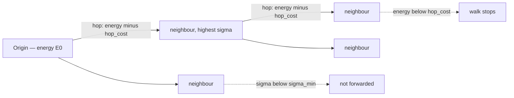

In most databases, knowledge sits still until someone asks for it. HyphaeDB inverts that: when you store a memory, the resulting diff *propagates* through the topology to the agents it is relevant to. You do not have to know who needs a fact in order for it to reach them — the mesh routes it for you.

This page explains how that propagation works. It is the core mechanism that makes the rest of the system — [the energy model](/concepts/energy-model), [the HNSW mesh](/concepts/hnsw-mesh), and [layer promotion](/concepts/layer-promotion) — fit together.

## What propagates

When you store knowledge, the server creates a `MemoryDiff`: a unit of knowledge with an embedding, a salience, a cell type, and an `origin` node. The diff is then released into the mesh as work.

Propagation is an **energy-bounded, asynchronous work-queue diffusion** (the HyphaeDB whitepaper, Algorithm 1). Each diff carries an energy budget. It is seeded at its origin node, delivered there, and then forwarded outward hop by hop. Every hop costs energy. When a diff can no longer afford to cross any remaining edge, it stops. There is no central scheduler deciding where knowledge goes — each node makes a local decision about which neighbours to forward to.

<Info>
Propagation never blocks the write that triggered it. Storing a memory only seeds the work queue; the diffusion runs asynchronously behind the response.
</Info>

A diff fans out from its origin, paying energy at every hop and stopping where it can no longer afford an edge — or where a neighbour is not relevant enough to forward to:



## Where a diff forwards next

At each node, the engine scores every neighbour and forwards the diff only to the neighbours that are both relevant enough and affordable.

A neighbour's relevance to a diff is a single combined score, `sigma`:

```text
sigma = 0.6 · semantic_relevance
      + 0.3 · declared_interest
      + 0.1 · salience
```

The three weights sum to `1.0`. The terms are:

- `semantic_relevance` — cosine similarity between the diff's embedding and the neighbour's embedding. The closer the topics, the higher this term.
- `declared_interest` — how strongly the neighbour has declared interest in this kind of knowledge, through a [beacon](/concepts/positioning-and-beacons). A node with no beacon (a bare agent) contributes nothing to this term — its delivery rests on `semantic_relevance` and `salience` alone.
- `salience` — how important the diff itself is.

A neighbour is a forwarding candidate only if `sigma >= sigma_min` (default `0.3`) **and** the diff still has enough energy to pay the hop: `diff.energy >= hop_cost`. The engine sorts the surviving candidates by `sigma` in **descending order** — most relevant first — and forwards a copy to each, subtracting the hop cost from that copy's energy as it goes. See [the energy model](/concepts/energy-model) for how `hop_cost` is computed.

## The walk, step by step

<Steps>
  <Step title="Seed at the origin">
    The diff is placed on the work queue with its target set to `diff.origin`. This is the only hop where the target equals the origin.
  </Step>
  <Step title="Deliver">
    The diff is delivered to the current node and recorded, so the same node is never delivered to twice within one propagation.
  </Step>
  <Step title="Mark the path">
    The current node is added to the diff's visited `path` set, and the hop count is incremented.
  </Step>
  <Step title="Score and filter neighbours">
    For each neighbour, compute `sigma` and `hop_cost`, and keep it only if `sigma >= sigma_min` and `diff.energy >= hop_cost`.
  </Step>
  <Step title="Forward in descending relevance order">
    Sort the kept neighbours by `sigma` descending. For each, clone the diff into a child, subtract the hop cost from the child's energy, increment its hop count, add the current node to its path, and enqueue it toward that neighbour.
  </Step>
</Steps>

In its clearest form, the walk is:

```text
terminate if out of energy or already visited
  → deliver(current)
  → mark current in path, increment hop_count
  → fetch gossip neighbours
  → score and filter (sigma >= sigma_min AND energy >= hop_cost)
  → sort kept neighbours by sigma descending
  → recurse into each child with energy -= hop_cost
```

## Invariants you can rely on

These properties hold for every propagation, and the rest of the system depends on them.

<Warning>
**Energy is non-increasing along any path.** Every hop subtracts a positive cost, so a diff's energy only ever falls as it travels. This is what guarantees propagation terminates rather than circulating forever.
</Warning>

- **Provenance is preserved.** A diff's `origin` node id is **immutable**. The node currently handling the diff is tracked by a separate moving cursor (the forwarding target), never by overwriting `origin`. This keeps a trustworthy record of where each piece of knowledge actually came from — which downstream [trust and provenance](/concepts/trust-and-provenance) scoring relies on.
- **Cycles are prevented by the `path` set.** Before delivering, the engine checks whether the current node is already in the diff's visited `path`. A node already on the path is skipped, so a diff cannot loop back on itself.
- **A contradiction travels farther.** A diff whose type is a contradiction is seeded with extra initial energy (a `contradiction_bonus` multiplier), so conflicting information reaches more of the mesh than an ordinary update would. See [the energy model](/concepts/energy-model).

## How this connects to the rest of the system

Propagation is the verb; the other concepts are the nouns it acts on. The walk traverses [the HNSW mesh](/concepts/hnsw-mesh) — the same graph used for vector recall doubles as the gossip topology. The budget that bounds the walk is [the energy model](/concepts/energy-model). The reach a source is allowed can be attenuated by [trust](/concepts/trust-and-provenance) — an opt-in behind `trust.energy_attenuation`, default `false`. And when a diff is delivered widely enough, it can earn [promotion up the layer hierarchy](/concepts/layer-promotion).

## Source

This page is a teaching restatement of the HyphaeDB specifications and whitepaper. It does not define new behaviour.

- [hyphae-gossip spec §4, §7, §8, §9](https://github.com/hyphae-db/hyphae-core/blob/main/specs/hyphae-gossip.md) — propagation walk, combined relevance `sigma`, invariants, and configuration defaults.
- The HyphaeDB whitepaper, Algorithm 1 — energy-bounded asynchronous diffusion.
