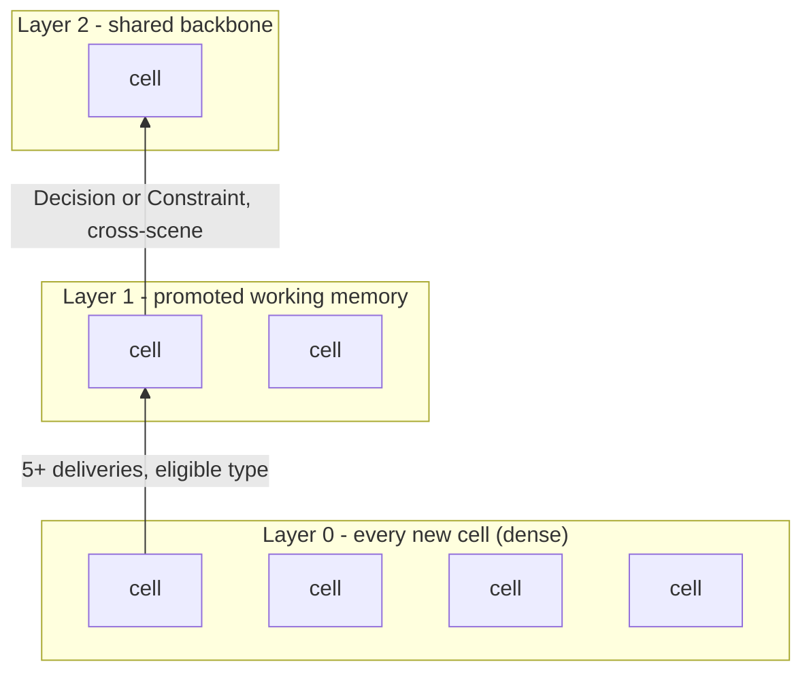

The mesh is the structure everything else runs on. It is a custom HNSW (Hierarchical Navigable Small World) graph, and it plays two roles at once: it is the **vector index** that answers recall queries, and it is the **topology** that [gossip propagation](/concepts/gossip-propagation) walks. There is one graph, not two — the same edges that let you search for nearest neighbours are the edges a memory diff travels along.

## Three semantic layers

The mesh has three layers — Layer 0, Layer 1, and Layer 2 — each with its own `M` (neighbour cap) and `ef_construction` (search width during insertion).

- **Layer 0** holds every node. Its neighbour cap is `m0 = 48` (which is `2 × m`, with `m = 24`).
- **Layers 1 and 2** hold progressively fewer nodes, and each caps a node's neighbours at `m`.

Higher layers are sparse and act as express lanes across the graph; Layer 0 is dense and holds the full detail. This same hierarchy is what [layer promotion](/concepts/layer-promotion) moves knowledge up through as it proves its value.

## How a node is inserted

Inserting a node is gossip-aware HNSW insertion:

<Steps>
  <Step title="Random layer assignment">
    The node is assigned a top layer at random, with roughly a `1/24` decay per level. This produces a logarithmic hierarchy: most nodes live only at Layer 0, and progressively fewer reach the higher layers.
  </Step>
  <Step title="Greedy descent">
    Starting from the entry point at the top layer, the insert greedily walks toward the new node's neighbourhood, descending one layer at a time.
  </Step>
  <Step title="Per-layer search">
    At each target layer, an `ef_construction`-width beam search finds the best candidate neighbours.
  </Step>
  <Step title="Heuristic neighbour selection">
    Up to `M` neighbours (`m0` at Layer 0) are chosen with a diversity-preserving heuristic — not a naive top-`M` — so the graph stays navigable.
  </Step>
  <Step title="Bidirectional gossip-aware edges">
    Each chosen connection is created as a bidirectional `GossipEdge`. If A links to B, B links back to A at the same layer, both with the same weight derived from the distance between them.
  </Step>
</Steps>

When a node ends up with more neighbours than its layer's cap allows, the graph prunes back to the highest-weight edges.

## Gossip-aware edges

An ordinary HNSW edge records only "these two nodes are near each other." A `GossipEdge` records that plus the metadata propagation needs — most importantly the connection `weight`, which sets the [hop cost](/concepts/energy-model) (`hop_cost = 1 / max(weight, 0.01)`), so stronger edges are cheaper for a diff to cross. Because the edges are bidirectional, a diff can flow in either direction along the same connection that recall uses.

This is the key idea: the graph is not a search index with a separate messaging overlay bolted on. The edges *are* the gossip channels.

## Eviction

`evict_node` is the inverse of insert. It removes a node and all of its incident edges — outbound and reverse — at every layer it occupies, re-links the affected neighbours to keep Layer 0 connected, and updates the entry point if the apex node is the one removed. It is the primitive the data-lifecycle tiering uses to bound how much of the graph stays resident in memory.

<Note>
Some node types are eviction-exempt and are never removed: Agent nodes, Beacon nodes, and any node that has reached Layer 2. Agents and [beacons](/concepts/positioning-and-beacons) must stay addressable, and Layer 2 is the ceiling for promoted knowledge — see [layer promotion](/concepts/layer-promotion).
</Note>

## One graph, two jobs

To recall knowledge, you search the mesh: a greedy descent from the top layer down to Layer 0 finds the nearest neighbours to your query. To propagate knowledge, gossip walks the mesh: a diff starts at its origin and forwards along high-weight edges to relevant neighbours. Both operations traverse the same nodes and the same `GossipEdge`s. Improving the graph for one improves it for the other.

## Source

This page is a teaching restatement of the HyphaeDB specifications. It does not define new behaviour.

- [hyphae-hnsw spec §4.2–4.4, §7, §8](https://github.com/hyphae-db/hyphae-core/blob/main/specs/hyphae-hnsw.md) — the three-layer architecture, gossip-aware insertion, `GossipEdge`, eviction, and configuration defaults.
